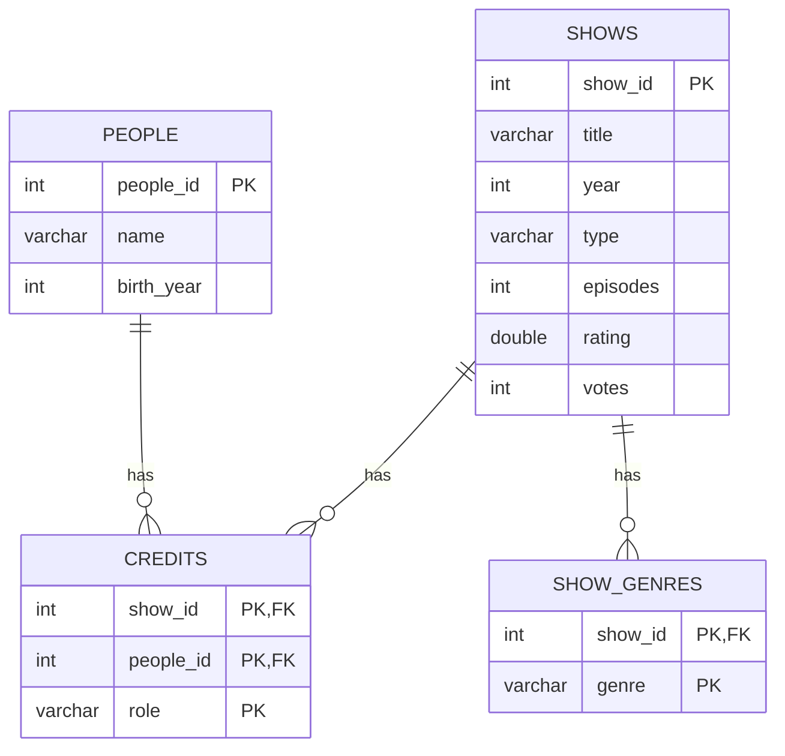

# TV Show Catalog ERD

## Assumptions

- A show can have more than one genre and many people involved, so I made different tables for each.
- Two shows can have the same name, so each one has an id.